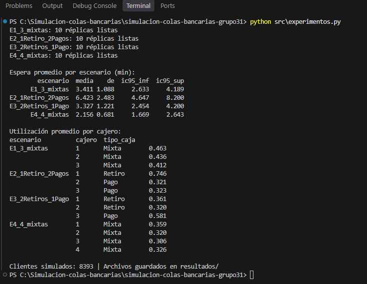
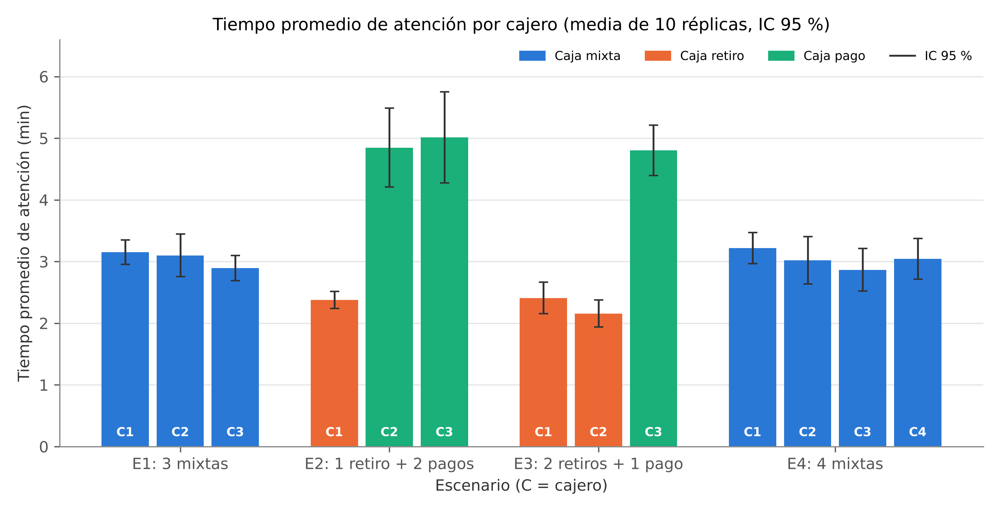
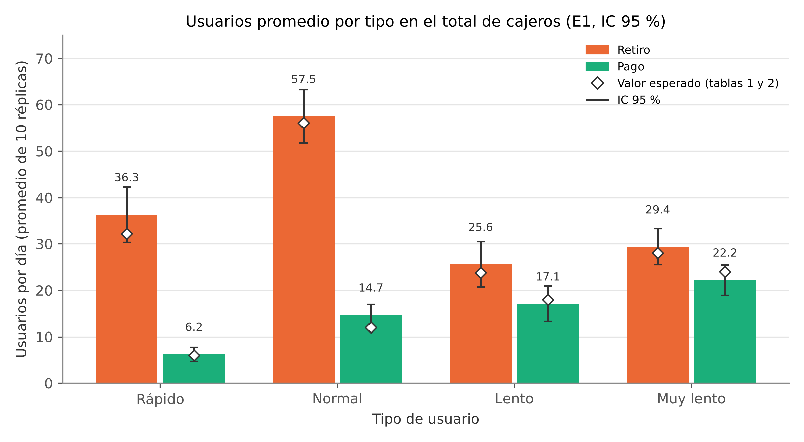
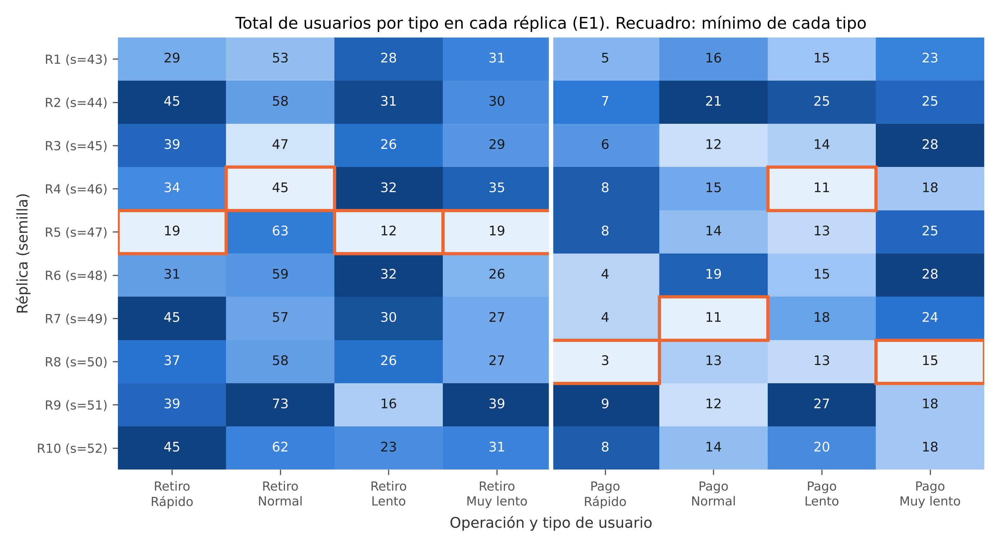

# Simulación de colas bancarias — Banco de Colombia (M/M/1)

Simulación de eventos discretos de los cajeros del Banco de Colombia para decidir cuántas cajas
deben atender exclusivamente pagos y cuántas retiros, y si hace falta un cajero adicional.

Actividad didáctica 2-M3 — Simulación, IU Digital de Antioquia. Grupo 31:
Gilliam Argel Monterroza, Leydi Correa Herrera, Sergio Andrés Agudelo Marulanda, Arley Steven Franco Galeano.

## Estructura

```
├── src/
│   ├── banco.py          # Modelo: datos de las tablas, simulación de un día y valores teóricos M/M/1
│   ├── experimentos.py   # 4 escenarios x 10 réplicas -> Excel y CSV
│   └── analisis_puntos_1_3.py  # Puntos 1, 2 y 3: estadísticas, IC 95 %, réplicas necesarias y figuras
├── resultados/
│   ├── resultados_simulacion_banco.xlsx   # todas las tablas (ver hojas abajo)
│   ├── clientes.csv                       # un registro por cliente atendido
│   ├── ejecucion.png                      # captura de la terminal (evidencia de ejecución)
│   ├── p1_atencion_por_cajero.csv         # Punto 1: atención por cajero (media, DE, mín, máx, IC 95 %)
│   ├── p1_pruebas.csv                     # Punto 1: comparación entre cajeros (ANOVA y Kruskal-Wallis)
│   ├── p2_usuarios_por_tipo.csv           # Punto 2: usuarios promedio por tipo (total y por cajero)
│   ├── p3_usuarios_por_replica.csv        # Punto 3: total de usuarios por tipo en cada réplica
│   └── replicas_necesarias.csv            # error relativo con 10 réplicas y réplicas necesarias
├── figuras/
│   ├── fig_p1_atencion_cajeros.png        # Punto 1 (300 dpi)
│   ├── fig_p2_usuarios_tipo.png           # Punto 2 (300 dpi)
│   └── fig_p3_usuarios_replica.png        # Punto 3 (300 dpi)
└── requirements.txt
```

## Instalación y ejecución

```bash
git clone https://github.com/sergioagudelo58-rgb/simulacion-colas-bancarias-grupo31.git
cd simulacion-colas-bancarias-grupo31
pip install -r requirements.txt
python src/experimentos.py          # 1) simulación -> resultados/clientes.csv y Excel
python src/analisis_puntos_1_3.py   # 2) puntos 1, 2 y 3 -> resultados/p*.csv y figuras/
```

### Evidencia de ejecución

Captura de la terminal al ejecutar `python src/experimentos.py`:



## Datos del modelo

| Operación | Tipo de usuario | Probabilidad | Media de servicio (min) | Media de llegada (min) |
|---|---|---|---|---|
| Retiro (70 %) | Rápido | 0.23 | 1 | 1 |
| | Normal | 0.40 | 2 | 2 |
| | Lento | 0.17 | 3 | 3 |
| | Muy lento | 0.20 | 4 | 3 |
| Pago (30 %) | Rápido | 0.10 | 3 | 1 |
| | Normal | 0.20 | 3 | 2 |
| | Lento | 0.30 | 5 | 3 |
| | Muy lento | 0.40 | 7 | 4 |

## Supuestos

1. Cada cajero es una cola M/M/1 independiente, con su propia fila y disciplina FIFO.
2. Al llegar, se sortea la operación (70 % retiro, 30 % pago) y el tipo de usuario (Tabla 2).
3. El tiempo hasta la siguiente llegada es exponencial con la media del tipo de cliente que llega (Tabla 1).
4. El cliente se asigna al azar, con igual probabilidad, a uno de los cajeros que atienden su operación.
5. El tiempo de servicio es exponencial con la media de su operación y tipo de usuario (Tabla 1).
6. El banco recibe clientes durante 480 minutos (8 horas); quienes ya están en fila se atienden hasta terminar.
7. La atención es inmediata cuando el cajero está libre y el desplazamiento es despreciable.

## Escenarios y réplicas

| Escenario | Cajeros |
|---|---|
| E1 | 3 cajas mixtas (situación actual) |
| E2 | 1 caja de retiros + 2 cajas de pagos |
| E3 | 2 cajas de retiros + 1 caja de pagos |
| E4 | 4 cajas mixtas (evaluar un cajero adicional) |

10 réplicas por escenario; la réplica r usa la semilla `42 + r` (43 a 52), la misma en todos los escenarios.

## Hojas del Excel de resultados

| Hoja | Contenido | Punto |
|---|---|---|
| `clientes` | Un registro por cliente: escenario, réplica, cajero, operación, tipo, llegada, espera, servicio | Todos |
| `por_cajero_replica` | Clientes, atención promedio, espera promedio y máxima, utilización por cajero y réplica | 1, 4 |
| `atencion_por_cajero` | Tiempo de atención por cajero: media, DE e IC 95 % | 1 |
| `usuarios_por_replica` | Total de usuarios de cada tipo en cada réplica | 2, 3 |
| `espera_por_escenario` | Espera promedio por escenario con IC 95 % | 4, 5 |
| `espera_por_tipo` | Espera promedio por escenario, operación y tipo de usuario | 4, 5 |
| `teorico_MM1` | λ, μ, ρ, Lq, Wq, W y L teóricos de cada cajero | Metodología |

## Resultados de los puntos 1, 2 y 3 (escenario E1, situación actual)

- **Punto 1.** Tiempo promedio de atención: cajero 3 = 2.89 min (menor) y cajero 1 = 3.15 min (mayor).
  La diferencia no es significativa (ANOVA p = 0.26), porque las tres cajas mixtas reciben la misma mezcla de clientes.
  Con cajas especializadas (E2 y E3) las cajas de pago tardan unas dos veces más que las de retiro (p < 0.001).
- **Punto 2.** En promedio llegan 209 usuarios por día: 148.8 de retiro y 60.2 de pago. El tipo más frecuente es
  retiro normal (57.5 por día). Las proporciones coinciden con la Tabla 2 (chi-cuadrado p = 0.14).
- **Punto 3.** La réplica 5 (semilla 47) tiene la menor cantidad de usuarios (173) y el mínimo en tres tipos de retiro.







## Reproducibilidad

Con las mismas semillas, ejecutar el script varias veces produce resultados idénticos.
Entorno probado: Python 3.13, numpy 2.5, pandas 3.0, scipy 1.18, openpyxl 3.1.
